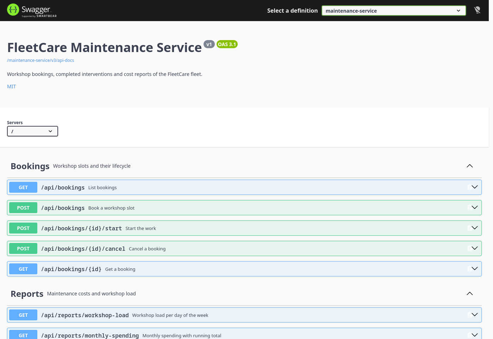
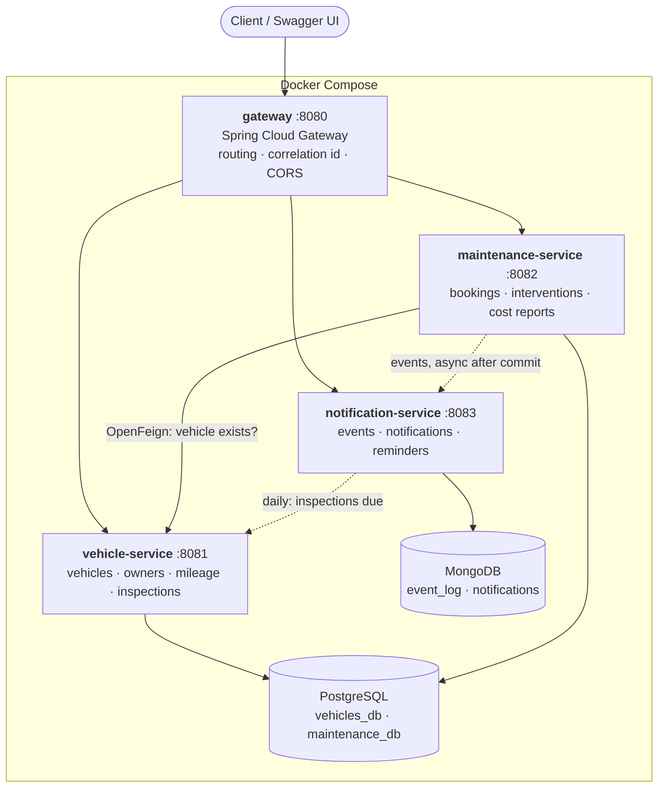
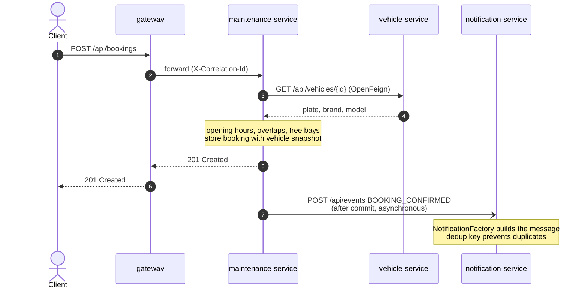

# FleetCare

[](https://github.com/xydani/fleetcare/actions/workflows/ci.yml)


[](LICENSE)

Spring Boot microservice backend for managing a vehicle fleet: vehicles and their owners, odometer readings and periodic inspections, workshop bookings and priced maintenance, notifications and reminders. It is the backend my Android app MyCar Manager should have had.

Three services, each with its own database, behind an API gateway; one command starts everything with demo data.



## Architecture



| Service | Responsibility | Storage |
|---|---|---|
| `gateway` | Single entry point: routes `/api/**`, adds an `X-Correlation-Id`, serves one Swagger UI for all services | – |
| `vehicle-service` | Vehicles, owners, odometer readings, inspections and their due dates, fleet statistics | PostgreSQL `vehicles_db` |
| `maintenance-service` | Workshop bookings and their lifecycle, priced interventions, cost reports | PostgreSQL `maintenance_db` |
| `notification-service` | Events from the other services, notifications, daily inspection reminders | MongoDB |

### From a booking to a notification



## Stack

Java 21 · Spring Boot 4.1 · Spring Cloud 2025.1 (Gateway, OpenFeign) · Spring Data JPA · Spring Data MongoDB · PostgreSQL 18 · MongoDB 7.0 · Flyway · MapStruct · springdoc-openapi · JUnit 5 · Mockito · AssertJ · Testcontainers · WireMock · JaCoCo · Docker Compose · GitHub Actions

## Quick start

All you need is Docker with Docker Compose:

```bash
docker compose up --build --wait
```

The first build takes a few minutes; then the whole system (two databases, three services, the gateway) is up with demo data. Everything is reached through the gateway on port 8080:

- **Swagger UI**: http://localhost:8080/swagger-ui.html (pick the service in the drop-down at the top)
- Stop with `docker compose down`; add `--volumes` to also delete the data.

Settings such as ports and the demo profile are in [`.env.example`](.env.example); copy it to `.env` to change them.

### A quick tour

The same tour, ready to run request by request, is in [`http/fleetcare.http`](http/fleetcare.http) (VS Code REST Client). Or follow it in the Swagger UI, or with any HTTP client against `http://localhost:8080`:

1. `GET /api/vehicles/1`: a demo vehicle with its current mileage and inspection status.
2. `POST /api/bookings` with `{"vehicleId": 1, "serviceType": "BRAKES", "startsAt": "<a future weekday>T09:00:00"}`.
3. `POST /api/bookings/{id}/start`, then `POST /api/bookings/{id}/complete` with `{"description": "Brake pads", "partsCost": 120, "labourHours": 1.5, "pricingPlan": "FLEET"}`: the fleet plan applies a 15% discount.
4. `GET /api/notifications?unread=true`: the booking and the completed work became notifications.
5. `POST /api/reminders/inspections`: creates reminders for overdue and upcoming inspections; run it twice and the second time creates none.
6. `GET /api/reports/monthly-spending` and `GET /api/vehicles/stats`: reports over the demo data.

## API

Every path below is served by the gateway on port 8080. Errors use [RFC 9457](https://www.rfc-editor.org/rfc/rfc9457) problem details: 400 for invalid input (with a per-field `errors` map), 404 for unknown resources, 409 for conflicts, 422 for broken business rules, 503 when a service needed for the request is unavailable.

### Vehicle service

| Method | Path | Description |
|---|---|---|
| `GET` `POST` | `/api/owners` | List (paginated) and create owners |
| `GET` `PUT` `DELETE` | `/api/owners/{id}` | Read, update, delete an owner |
| `GET` `POST` | `/api/vehicles` | List with filters (`brand`, `fuelType`, `ownerId`) and register vehicles |
| `GET` `PUT` `DELETE` | `/api/vehicles/{id}` | Vehicle detail with current km and inspection status, update, delete |
| `GET` `POST` | `/api/vehicles/{id}/mileage` | Mileage history (window functions) and new readings |
| `GET` `POST` | `/api/vehicles/{id}/inspections` | Inspection history and new inspections |
| `GET` | `/api/vehicles/inspections/expiring?days=30` | Vehicles with an overdue or upcoming inspection |
| `GET` | `/api/vehicles/stats` | Fleet statistics by fuel type, age and brand |

### Maintenance service

| Method | Path | Description |
|---|---|---|
| `GET` `POST` | `/api/bookings` | List (filters `vehicleId`, `status`) and book a workshop slot |
| `GET` | `/api/bookings/{id}` | Booking detail |
| `POST` | `/api/bookings/{id}/start` `/cancel` | Lifecycle: `BOOKED → IN_PROGRESS → COMPLETED`, cancellable until completed |
| `POST` | `/api/bookings/{id}/complete` | Record the intervention, priced by plan (`STANDARD`, `WARRANTY`, `FLEET`) |
| `GET` | `/api/interventions` | Interventions, filter by `vehicleId` for a vehicle's history |
| `GET` | `/api/reports/brands/average-cost` | Average cost per brand (`HAVING`) |
| `GET` | `/api/reports/brands/top-interventions` | Most expensive interventions per brand (`RANK() OVER`) |
| `GET` | `/api/reports/monthly-spending?year=` | Spending per month with running total (CTE, `SUM() OVER`) |
| `GET` | `/api/reports/workshop-load` | Booked hours per weekday |

### Notification service

| Method | Path | Description |
|---|---|---|
| `POST` | `/api/events` | Report an event (`BOOKING_CONFIRMED`, `MAINTENANCE_COMPLETED`, `INSPECTION_DUE`); repeats are detected |
| `GET` | `/api/events/stats?days=30` | Events per day and type (aggregation pipeline) |
| `GET` | `/api/notifications` | Newest first, filters `unread=true` and `vehicleId` |
| `GET` | `/api/notifications/unread-count` | Number of unread notifications |
| `PATCH` | `/api/notifications/{id}/read` | Mark as read |
| `POST` | `/api/reminders/inspections` | Run the daily inspection check now |

## Design patterns

| Pattern | Where | Why |
|---|---|---|
| **Strategy** | [`CostCalculationStrategy`](maintenance-service/src/main/java/io/github/xydani/fleetcare/maintenance/pricing/CostCalculationStrategy.java) with one implementation per pricing plan, picked by [`CostStrategyResolver`](maintenance-service/src/main/java/io/github/xydani/fleetcare/maintenance/pricing/CostStrategyResolver.java) | A new pricing plan is a new class; the service that prices interventions does not change (open/closed). The resolver fails at startup if a plan has no strategy. |
| **Factory** | [`NotificationFactory`](notification-service/src/main/java/io/github/xydani/fleetcare/notification/notification/NotificationFactory.java) | Callers pass an event type and a free-form payload and get a ready notification; which fields each type needs and how its message reads stay in one place. |
| **Builder** | [`VehicleDetailResponse.builder()`](vehicle-service/src/main/java/io/github/xydani/fleetcare/vehicle/vehicle/dto/VehicleDetailResponse.java) | A response assembled from several sources (vehicle, owner, latest reading, inspection status) without a constructor with a dozen arguments. |
| **DTO + mapper** | Records for every request and response, mapped by MapStruct ([`VehicleMapper`](vehicle-service/src/main/java/io/github/xydani/fleetcare/vehicle/vehicle/VehicleMapper.java), [`BookingMapper`](maintenance-service/src/main/java/io/github/xydani/fleetcare/maintenance/booking/BookingMapper.java)) | Entities never leave the service; the API can change without touching the database model. |
| **Repository + Specification** | Spring Data repositories, [`VehicleSpecifications`](vehicle-service/src/main/java/io/github/xydani/fleetcare/vehicle/vehicle/VehicleSpecifications.java) for optional filters | Filters combine without a query per combination. |
| **Adapter** | [`VehicleLookup`](maintenance-service/src/main/java/io/github/xydani/fleetcare/maintenance/vehicle/VehicleLookup.java) over the Feign [`VehicleClient`](maintenance-service/src/main/java/io/github/xydani/fleetcare/maintenance/vehicle/VehicleClient.java) and its [`ErrorDecoder`](maintenance-service/src/main/java/io/github/xydani/fleetcare/maintenance/vehicle/VehicleClientErrorDecoder.java) | The rest of the service sees a snapshot or a domain exception, never Feign. |
| **Domain events (observer)** | [`NotificationForwarder`](maintenance-service/src/main/java/io/github/xydani/fleetcare/maintenance/notification/NotificationForwarder.java) listens with `@TransactionalEventListener` and `@Async` | Booking code does not know about notifications; nothing is sent for a rolled-back transaction. |
| **State in enums** | [`InspectionOutcome`](vehicle-service/src/main/java/io/github/xydani/fleetcare/vehicle/inspection/InspectionOutcome.java) (expiry per outcome), `BookingStatus` (allowed transitions) | The rule lives with the value it belongs to. |

## Queries worth a look

Complex reads use native SQL through `JdbcClient`, mapped onto records; simple ones are Spring Data derived queries.

**Mileage history with window functions**, [`MileageHistoryQuery`](vehicle-service/src/main/java/io/github/xydani/fleetcare/vehicle/mileage/MileageHistoryQuery.java): km and days since the previous reading, plus a moving average over the last three readings.

```sql
WITH deltas AS (
    SELECT reading_date,
           km,
           km - LAG(km) OVER w                     AS km_since_previous,
           reading_date - LAG(reading_date) OVER w AS days_since_previous
    FROM mileage_reading
    WHERE vehicle_id = :vehicleId
    WINDOW w AS (ORDER BY reading_date)
)
SELECT reading_date, km, km_since_previous, days_since_previous,
       ROUND(AVG(km_since_previous) OVER (
           ORDER BY reading_date ROWS BETWEEN 2 PRECEDING AND CURRENT ROW
       ))::int AS moving_average_km
FROM deltas
ORDER BY reading_date
```

**Most expensive interventions per brand**, [`ReportQuery`](maintenance-service/src/main/java/io/github/xydani/fleetcare/maintenance/report/ReportQuery.java): `RANK()` restarts for every brand, and ties share a rank.

```sql
WITH ranked AS (
    SELECT b.vehicle_brand AS brand,
           RANK() OVER (PARTITION BY b.vehicle_brand ORDER BY i.total_cost DESC) AS cost_rank,
           i.id AS intervention_id, b.vehicle_plate AS plate, b.service_type,
           i.total_cost, i.completed_at::date AS completed_on
    FROM intervention i
    JOIN booking b ON b.id = i.booking_id
)
SELECT * FROM ranked
WHERE cost_rank <= :limit
ORDER BY brand, cost_rank, intervention_id
```

Also:

- [`InspectionDueQuery`](vehicle-service/src/main/java/io/github/xydani/fleetcare/vehicle/inspection/InspectionDueQuery.java): latest inspection per vehicle with `DISTINCT ON`, including vehicles never inspected (due four years after registration).
- [`FleetStatsQuery`](vehicle-service/src/main/java/io/github/xydani/fleetcare/vehicle/stats/FleetStatsQuery.java): share per fuel type with `SUM(count(*)) OVER ()`, age bands with `CASE`.
- [`ReportQuery`](maintenance-service/src/main/java/io/github/xydani/fleetcare/maintenance/report/ReportQuery.java): average cost per brand with `HAVING`, monthly spending with a running total over all twelve months (`generate_series`, `SUM() OVER`).
- [`EventStatsQuery`](notification-service/src/main/java/io/github/xydani/fleetcare/notification/stats/EventStatsQuery.java): MongoDB aggregation pipeline (`$match`, `$project`, `$group`, `$sort`) counting events per local day and type.
- Schema and constraints in the Flyway migrations: [vehicle-service](vehicle-service/src/main/resources/db/migration), [maintenance-service](maintenance-service/src/main/resources/db/migration).

## Design decisions and trade-offs

- **A database per service.** Each service owns its data and can change its schema alone. The maintenance service cannot join the vehicle table, so each booking stores a **snapshot** of plate, brand and model ([`VehicleSnapshot`](maintenance-service/src/main/java/io/github/xydani/fleetcare/maintenance/vehicle/VehicleSnapshot.java)); reports group by those columns, and history stays accurate if a vehicle is later edited.
- **One PostgreSQL container, two databases.** Lighter than two containers for a project this size, with the data still separate.
- **MongoDB for notifications.** Event payloads differ per type and are written once; a TTL index drops events after 90 days ([`MongoIndexConfig`](notification-service/src/main/java/io/github/xydani/fleetcare/notification/common/config/MongoIndexConfig.java)). Version 7.0, because MongoDB 8.x refuses to start on Linux kernels from 6.19 to 7.0.13, which includes GitHub's CI runners.
- **No service registry.** With three services, static routes and Docker Compose's DNS are enough; Eureka would add moving parts without benefit.
- **HTTP events instead of a message broker.** The maintenance service forwards events after commit and asynchronously, best effort: a failure is logged and never fails the booking. The notification service is idempotent (a deduplication key under a unique index), so retries are safe. A broker would add guaranteed delivery; see future work.
- **Double bookings blocked twice.** The service checks first for a clear 409, and a PostgreSQL `EXCLUDE USING gist` constraint guarantees it when two requests race.
- **Errors the client can act on.** A 404 from the vehicle service becomes a clean 404; any other failure or timeout becomes a 503 instead of a 500 ([`VehicleClientErrorDecoder`](maintenance-service/src/main/java/io/github/xydani/fleetcare/maintenance/vehicle/VehicleClientErrorDecoder.java)).
- **Correlation id at the edge.** The gateway ([`CorrelationIdFilter`](gateway/src/main/java/io/github/xydani/fleetcare/gateway/filter/CorrelationIdFilter.java)) reuses the client's id only if it is short and plain, so it cannot inject text into the logs.
- **Time is injected.** Every "today" comes from a `Clock` bean, so date rules (inspection due, opening hours, statistics windows) are tested with a fixed clock.

## Testing

```bash
./mvnw verify
```

Docker must be running: the integration tests start real databases.

| Kind | Tools | Examples |
|---|---|---|
| Unit | JUnit 5, Mockito, AssertJ, parameterized tests | services, pricing strategies, notification factory, booking lifecycle |
| Web slice | `@WebMvcTest` | status codes, validation errors, problem details |
| Persistence | `@DataJpaTest`, `@DataMongoTest`, Testcontainers | native SQL, exclusion constraint, TTL and unique indexes, aggregation |
| Integration | `@SpringBootTest`, Testcontainers, WireMock | whole booking flow with the other services stubbed; Feign timeouts and errors |
| Gateway | `@SpringBootTest` on a random port, WireMock | routing, correlation id, aggregated OpenAPI documents, CORS |

- **Coverage gate**: `jacoco:check` fails the build if a module drops below 85% of lines or 80% of branches. The report for all modules together is in `coverage-report/target/site/jacoco-aggregate/index.html`.
- **CI** (GitHub Actions) runs two jobs on every push and pull request: the full build with tests, which publishes a coverage table and the HTML report, and a smoke test that starts the whole system with Docker Compose and calls each service through the gateway.

## Local development

Requirements: JDK 21 or newer (no Maven install needed: use the `./mvnw` wrapper) and Docker.

Start only PostgreSQL (with `vehicles_db` and `maintenance_db`) and MongoDB, then run the services you work on from the IDE or with Maven:

```bash
docker compose up -d postgres mongo
```

Default credentials are in [`.env.example`](.env.example); to change them, copy the file to `.env`.

#### Run the vehicle service

```bash
./mvnw -pl vehicle-service spring-boot:run -Dspring-boot.run.profiles=demo
```

The `demo` profile loads sample owners, vehicles, mileage readings and inspections. Without it the database only gets the schema.

Swagger UI: http://localhost:8081/swagger-ui.html

Alternatively, run `TestVehicleServiceApplication` from the IDE: it starts its own PostgreSQL container through Testcontainers, no `docker compose` needed.

#### Run the maintenance service

```bash
./mvnw -pl maintenance-service spring-boot:run -Dspring-boot.run.profiles=demo
```

It needs the vehicle service on port 8081 to create bookings. The `demo` profile loads about fourteen months of bookings and priced interventions for the demo fleet, plus upcoming bookings. Notifications go to port 8083; while the notification service is not running they are logged and dropped.

Swagger UI: http://localhost:8082/swagger-ui.html

#### Run the notification service

```bash
./mvnw -pl notification-service spring-boot:run
```

Every day at 07:00 it asks the vehicle service for overdue and upcoming inspections and creates one reminder per vehicle and due date. Change the schedule with `REMINDERS_CRON` (`-` disables it), or run the check at once with `POST /api/reminders/inspections`.

Swagger UI: http://localhost:8083/swagger-ui.html

#### Run the gateway

```bash
./mvnw -pl gateway spring-boot:run
```

The single entry point on port 8080: every `/api/**` call goes through it to the right service.

- **Swagger UI for the whole API**: http://localhost:8080/swagger-ui.html, with a drop-down to pick the service.
- **Correlation id**: every response carries an `X-Correlation-Id` header (the client's own, if valid, or a new UUID), which is also sent to the service and written in the gateway's request log with status and duration.
- **CORS** for browser front ends, configured once here (`CORS_ALLOWED_ORIGINS`).
- Service URLs come from `VEHICLE_SERVICE_URL`, `MAINTENANCE_SERVICE_URL` and `NOTIFICATION_SERVICE_URL` (localhost by default). Routes are static: with three services a service registry such as Eureka would add moving parts without benefit.

## Project structure

```
fleetcare/
├── pom.xml                 parent: dependency management, JaCoCo, coverage gate
├── vehicle-service/
├── maintenance-service/
├── notification-service/
├── gateway/
├── coverage-report/        aggregated JaCoCo report
├── docker/init-db.sql      creates vehicles_db and maintenance_db
├── docker-compose.yml      the whole system
├── Dockerfile              one multi-stage image definition for every service
├── http/fleetcare.http     runnable API tour
└── .github/workflows/      CI
```

Inside each service, code is organised **by feature** (`vehicle`, `booking`, `notification`, …), with `common` for error handling and configuration.

## Future work

- **Message broker** (Kafka or RabbitMQ) with an outbox table, for guaranteed delivery of events instead of best-effort HTTP.
- **Resilience4j** circuit breaker and retries around the calls between services.
- **Security**: OAuth2 / JWT validated at the gateway, with roles for workshop staff and owners.
- **Observability**: the correlation id in every service's logs (MDC), distributed tracing with OpenTelemetry, metrics dashboards.
- **Deployment** on Kubernetes, where service discovery and configuration come from the platform.

## License

[MIT](LICENSE)
